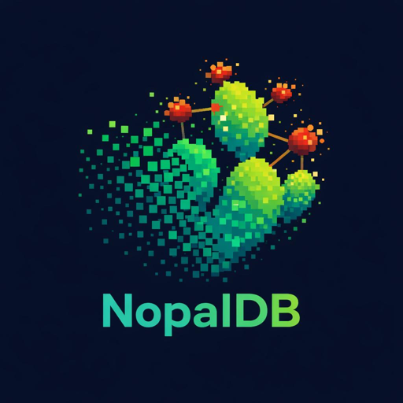

# nopaldb-mcp

<p align="center">
  
</p>

Servidor [MCP](https://modelcontextprotocol.io) para [NopalDB](https://github.com/sharop/nopaldb): expone consultas de grafo, traversal, algoritmos y razonamiento OWL como tools que cualquier cliente MCP (Claude Desktop, Claude Code, Cursor…) puede invocar.

Soporta dos transportes:

- **stdio** — el modo estándar para Claude Desktop / Claude Code.
- **HTTP/SSE** — para clientes remotos, con hardening por defecto: bind a loopback, bearer token obligatorio para exponer en red (comparación en tiempo constante) y CORS restringido.

## Quickstart

```bash
# Compilar
cargo build --release

# Servir una DB en modo solo lectura (stdio)
./target/release/nopaldb-mcp --db /ruta/a/mi_grafo.db --readonly
```

Configuración de Claude Desktop (`~/.config/claude/claude_desktop_config.json`):

```json
{
  "mcpServers": {
    "nopaldb": {
      "command": "/ruta/absoluta/a/nopaldb-mcp",
      "args": ["--db", "/ruta/absoluta/a/mi_grafo.db", "--readonly"]
    }
  }
}
```

Claude Code:

```bash
claude mcp add nopaldb -- /ruta/absoluta/a/nopaldb-mcp --db /ruta/absoluta/a/mi_grafo.db --readonly
```

Guía completa (Claude Desktop, Claude Code, modo escritura, troubleshooting): [docs/MCP_CLAUDE_DESKTOP.md](docs/MCP_CLAUDE_DESKTOP.md).

### Transporte HTTP/SSE

```bash
# Loopback sin token (solo local)
nopaldb-mcp --db graph.db --transport sse --port 8080

# Exponer en red: exige un bearer token (fail-closed sin él)
NOPALDB_MCP_TOKEN=secreto nopaldb-mcp --db graph.db --transport sse --host 0.0.0.0
```

### Flags principales

| Flag | Descripción |
|------|-------------|
| `--db <path>` | Directorio de la base NopalDB |
| `--readonly` | Deshabilita ADD/UPDATE/DELETE/CREATE/DROP |
| `--transport stdio\|sse` | Transporte (default `stdio`) |
| `--host`, `--port` | Bind del transporte SSE (default `127.0.0.1:8080`) |
| `--auth-token` / `NOPALDB_MCP_TOKEN` | Bearer token para SSE |
| `--cors-origin <origen>` | Orígenes CORS permitidos (repetible) |
| `--log-queries` | Loguea NQL a stderr |

## Compatibilidad

| nopaldb-mcp | Motor `nopaldb` | Formato de la base |
|---|---|---|
| 0.6.x | 0.10.16 o posterior (0.10.x) | redb |
| 0.5.x | 0.5.x | sled |

Desde 0.6.0 el servidor ya no abre bases sled: el motor retiró sled en 0.8.0. Una base sled se migra a redb con la CLI de `nopaldb` 0.7, una sola vez:

```bash
cargo install nopaldb --version 0.7.0 --features cli
nopaldb migrate /ruta/base_sled /ruta/base_redb
```

## Tools expuestas

**Consulta y esquema**

- `graph_query` — ejecuta NQL (FIND, EXPLAIN; ADD/UPDATE/DELETE si el servidor no corre con `--readonly`)
- `nql_syntax` — referencia de sintaxis NQL, filtrable por tipo de sentencia
- `schema_info` — labels, tipos de arista, conteos de nodos y aristas
- `schema_by_kind` — esquema agrupado por label con conteos por frecuencia

**Nodos y traversal**

- `get_node` — nodo por id (UUID) o nombre, con filtro opcional por label
- `get_neighbors` — vecinos de un nodo (dirección y tipo de arista opcionales)
- `find_path` — camino más corto entre dos nodos por nombre

**Escritura idempotente** (rechazadas con `--readonly`)

- `upsert_node` — upsert por clave de negocio (label, key): create/update/no-op
- `delete_node` — borrado por clave de negocio, idempotente

**Búsqueda y algoritmos**

- `search_hybrid` — RRF de full-text (tantivy) + vectorial (HNSW)
- `similar_nodes` — vecinos semánticos por embedding (HNSW)
- `run_pagerank` — top-N nodos por PageRank, con filtro opcional por label

**Ontología OWL** (requiere datos importados vía `import_turtle`)

- `classify_node` — membership de clase, incluyendo transitivo por jerarquía de subclases
- `list_instances` — individuos de una clase (herencia transitiva incluida)
- `list_subclasses` — subclases directas e indirectas de una clase

**Contexto de proyecto / exportación**

- `export_context_arrow` — exporta un subgrafo masivo a memoria compartida (mmap)
- `index_project_structure` — indexación inicial de la topología de un proyecto
- `record_episodic_event` — registra commits semánticos con sincronización JIT de entidades
- `rename_project_entity` — renombra la ruta física de una entidad preservando su historial
- `get_local_causal_context` — contexto causal asociado a un archivo o entidad
- `validate_and_commit_pr_context` — sella el contexto de un PR en el pipeline CI/CD

**Recursos MCP**: `nopal://schema` (esquema del grafo) y `nopal://stats` (estadísticas).

## Notebook de ejemplo

[`notebooks/06_mcp_ontologia.ipynb`](notebooks/06_mcp_ontologia.ipynb) verifica la infraestructura MCP end-to-end contra una ontología biomédica de juguete: compila el binario, genera la DB OWL y ejercita `classify_node`, `list_instances` y `list_subclasses` vía JSON-RPC.

## Relación con el engine

Este repositorio nació como la app `nopaldb-mcp` dentro de [sharop/nopaldb](https://github.com/sharop/nopaldb) y fue separado a su propio repo **preservando el historial git**. Depende del engine como crate publicado en crates.io ([`nopaldb`](https://crates.io/crates/nopaldb)); los issues del engine van en el repo del engine.

## Licencia

[AGPL-3.0-only](LICENSE). El servidor MCP es una aplicación y usa una licencia más estricta que la biblioteca `nopaldb` (MPL-2.0).
